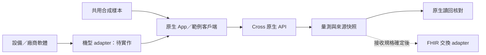

# Cross Developers

**讓設備、醫療軟體與健康資料更容易連接。**

Cross 的方向是 AIoT 健康資料平台：廠商保留既有設備與系統，透過共用 App 與 API 將量測接起來。預約是平台的參考應用之一。

本包是 **本機 Developer Preview 0.3.1** 的文件與範例，已涵蓋心率及合成單導程 ECG。[公開文件庫](https://github.com/twinhao/cross-developers)採用 [MIT 授權](LICENSE)，方便廠商使用與修改範例。沒有提供公開託管 API，也不是正式 SDK。

## 開始串接

1. [快速開始](docs/quickstart.md)：不需原產品原始碼，即可啟動獨立本機沙盒。
2. [API 契約](docs/api.md)：登錄、接收、原生查詢、去重及錯誤處理。
3. [ECG 波形](docs/ecg.md)：導程、取樣率、µV 與跨語言校驗規則。
4. [App 整合](docs/app-integration.md)：先保存，再補傳及核對；目前 App 能力與限制。
5. [廠商接入資料](docs/vendor-onboarding.md)：實機 adapter 所需的最小資訊。
6. [交付路線](docs/roadmap.md)：哪些已完成，哪些會在後續交付。

[OpenAPI 3.1 文件](openapi/cross-sandbox.openapi.json) · [Python 範例](examples/python/upload.py) · [JavaScript 範例](examples/javascript/upload.mjs)



## 目前能驗證什麼

| 能力 | 狀態 |
|---|---|
| 病人／設備的來源識別與登錄 | 本機沙盒可用 |
| 心率接收、保存、原生查詢與重送去重 | 本機沙盒可用 |
| 完整合成 ECG 片段與校驗 | 本機沙盒可用 |
| iOS／Android 加密保存、重啟恢復、前景補傳及波形顯示 | 原生 App 開發版本已驗證；App 原始碼未包含於本包 |
| 真實設備、BLE／Wi-Fi／USB 或廠商 SDK adapter | 待指定機型 |
| 多租戶、正式設備與病人配對授權 | 待實作 |
| Webhook、背景退避補傳及串流／多導程 | 待實作 |
| 正式 FHIR／TW Core／健保資料交換 | 待接收規格；未宣告相容性驗證通過 |
| AI 分析或診斷 | 未提供 |

ECG 僅接受 `signal_origin=simulator`；單一身份與 demo- 識別碼供虛構資料使用。完整 FHIR server 不在本版範圍，ECG FHIR 匯出回 `501`。

## 驗證範例包

安裝 [沙盒依賴](examples/local-sandbox/requirements.txt) 後，在本包根目錄執行：

```sh
python3 scripts/verify.py
```

腳本會在 loopback 隨機埠啟動本包的範例服務，以暫存資料庫驗證 Python／JavaScript 的實際 HTTP 流程、OpenAPI 一致性與錯誤情境，結束後停止服務及清除暫存資料。JavaScript 需 Node.js；未安裝時會明確報告略過，不視為已驗證。

驗證環境：Python 3.14、Node.js 22。API 服務與資料模型由 Cross 沙盒產生，範例不依賴正式預約服務、帳號或內部資料庫。

GitHub Actions 會在每次推送與 pull request 執行 API 測試及兩種語言的 HTTP 流程。[查看驗證結果](https://github.com/twinhao/cross-developers/actions)。
